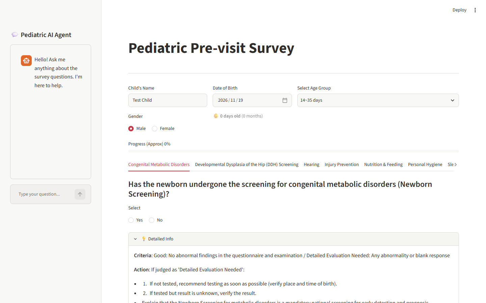
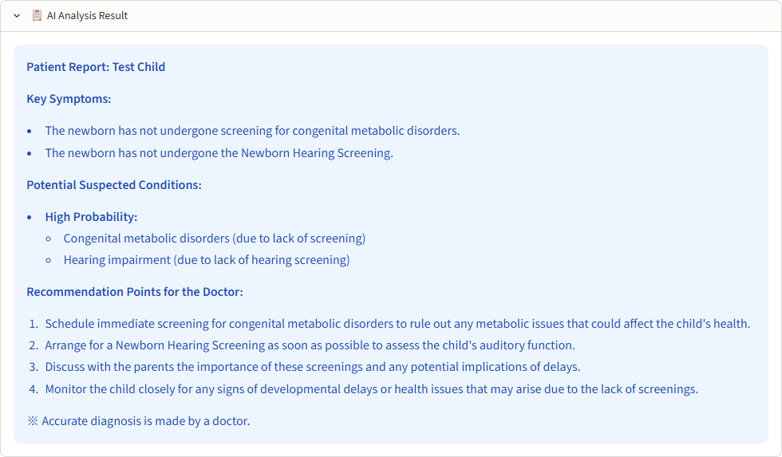
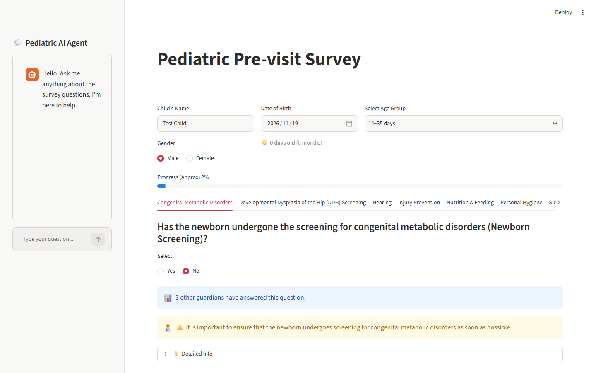
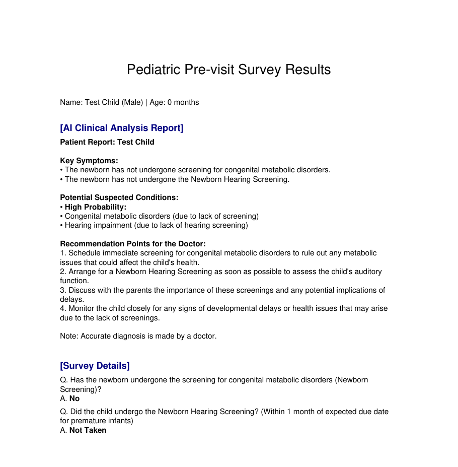

# Pediatric Pre-visit Survey & CDSS Agent  
  
  
  
  


---

## Project Overview
**Smart Pediatric Pre-visit Survey & CDSS Agent** is an intelligent pediatric pre-visit survey and clinical decision-support system developed using data from the Woori Children’s Hospital. The questionnaires exist in Korean and English; the runnable app is the English version.

The system provides:  
- A **dynamic age-specific survey**,  
- A **RAG-based AI parenting assistant**,  
- Automated **clinical summary reports for physicians**,  
- **Real-time warning detection**, and  
- **Downloadable PDF reports** for caregivers and clinicians.

The repository has two folders:

```
infant_survey_app_eng/  # English app (Streamlit) and questionnaires
infant_survey_app/      # Korean questionnaires and modules
```


---

## Key Features & Screenshots

### 1. Dynamic Survey Generation  
Automatically calculates the child's age in days and loads the correct age-appropriate survey.  



---

### 2. AI Parenting Chatbot (RAG-based)  
Provides evidence-based Q&A using vector search over pediatric medical documents.  


---

### 3. Clinical CDSS Summary for Physicians  
Generates a structured medical summary and risk notes based on survey responses.  



---

### 4. Real-time Risk Detection  
Instant alerts fire when guardian inputs indicate urgent or abnormal symptoms.  



---

### 5. PDF Report Generation  
Caregivers and clinicians can download a comprehensive PDF report.  



---

## Evaluation

The real-time risk alert (feature 4) was evaluated against 40 questionnaire items labelled from the hospital's own criteria.
The current prompt caught 93.3% of flagged answers with 6.7% false alarms, and two items were judged in the reverse direction.
Prompt changes traded misses for false alarms, so for choice items the alert should follow the hospital criteria directly, with the LLM kept for free-text answers and wording.
Details, results and how to re-run: [eval/README.md](eval/README.md)

---

## Directory Structure

```plaintext
root/
├── README.md
├── requirements.txt
├── infant_survey_app_eng/        # English app (runnable)
│   ├── app.py                    # Streamlit app
│   ├── agents/chains.py          # RAG chatbot chain
│   ├── config/questionnaires/    # age-specific questionnaire (JSON)
│   ├── modules/                  # schema, response saving
│   └── utils/                    # embeddings, vector store, splitters
├── infant_survey_app/            # Korean questionnaire and modules (app code is in the English version)
└── eval/                         # evaluation of the real-time risk alert
```

## Tech Stack

- Frontend: Streamlit
- AI / LLM: LangChain, OpenAI GPT-4o-mini
- Vector DB: ChromaDB
- Utilities: Pydantic, ReportLab

## Installation & Usage

1. Clone the repository
   ```bash
   git clone https://github.com/tommyoon0827/Pediatric_previsit_ai_agent.git
   cd Pediatric_previsit_ai_agent
   ```
2. Install dependencies (Python 3.10+)
   ```bash
   pip install -r requirements.txt
   ```
3. Set your OpenAI API key as an environment variable (the app reads `OPENAI_API_KEY`; it does not load a `.env` file)
   ```bash
   export OPENAI_API_KEY=...        # PowerShell: $env:OPENAI_API_KEY = Read-Host "key"
   ```
   Never commit API keys.
4. Run the app from inside the app folder (paths such as `config/questionnaires/...` are relative)
   ```bash
   cd infant_survey_app_eng
   streamlit run app.py
   ```
   The parenting chatbot answers from documents in `infant_survey_app_eng/data/docs/` (PDF, DOCX, TXT). The hospital documents are not included in this repository, so add your own to use the chatbot.

## License

MIT License © 2025 Yoon
